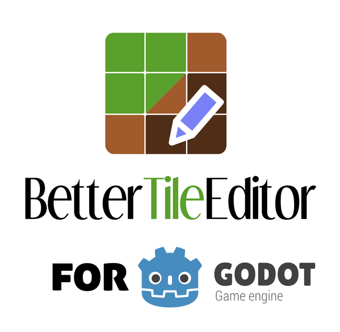

# Better Tile Editor

A fork of [BetterTerrain](https://github.com/Portponky/better-terrain) by
[Portponky](https://github.com/Portponky), with extra terrain modes and editor tools.

 <a href="https://youtu.be/cDmZ1YRWEU0">Watch every feature in 8 minutes</a>

## What's added

- Patch terrains
- Multi-tile objects and forest painting
- Scatter painting
- Single-tile and tile-group brushes
- Automatic cliff faces
- Terrain groups, search and favourites
- Terrain thumbnails and previews
- Brush sizes from 1×1 to 8×8
- Map selection by rectangle or magic wand, copy, paste and stamping; one click selects the tiles buried under walls and cliff faces
- Fill by visible area or current layer
- Live terrain updates
- Floating editor dock
- Must-not-match peering, from [BetterTerrain PR #144](https://github.com/Portponky/better-terrain/pull/144)
- Stretch terrains: one block of tiles that grows to fill any region
- A slope tool for 2×1 and 1×1 slopes
- Quick tile animations from a selection of frames, looping or ping-pong
- A Collisions tool: click tiles, in the atlas or on the map, to make them solid
- Complete terrain: builds the pieces a Match terrain is missing from quarters of the ones you drew
- A collision shape editor: detect shapes from the sprite or draw them by hand
- A Custom data tool to paint, inspect and pick tile custom data, with presets
- Tiles you haven't set up in the TileSet show dimmed in the Tiles view and become tiles the moment you use them, no Atlas setup needed (hide them in Options)
- Seams: mark cells where a terrain stops joining, to break it on purpose

## Highlights

- **Patch:** paint a region from a sample, keeping its borders and end pieces.
- **Stretch:** mark a waterfall, a bridge or a rug and paint it at any size. One row
  and one column repeat, and a smaller region drops middle rows first.
- **Multi-tile objects:** paint whole trees and other multi-tile objects. Separate
  and joined variants keep the pieces together, even when objects touch.
- **Forest painting:** paint an area to fill it with overlapping trees, including
  clearings. The trees keep their outlines and trunks around the edges.
- **Cliff faces:** paint the plateau and the rock faces follow its edges. Stack
  layers to build terraced hills.

## Must-not rules

A tile can say what may **not** touch one of its sides, not only what must. It
works in Match Tiles terrains, with the usual peering tool:

1. Pick the terrain in the list.
2. Click a side of a tile: it must match that terrain.
3. Click it again: it must **not** (a red crossed-out dot). Click again to go back.
4. Right click clears it.

Forbid a category to forbid every terrain in it, or Decoration to forbid an empty
cell. Use it for tiles defined by what they lack: a notch, a tip, or the corner on
top of a 2×1 slope.

## Seams

A seam is a cell where terrain stops joining. Use it to break a terrain on purpose:
two patches of grass that touch but keep their edges, a gap in a cliff wall, a tile
the autotiler must not touch.

1. Pick **Seams** at the top of the terrain list.
2. Left click (pencil, line or rectangle) to add seams, right click to remove them.
   They show as red crosses on the map while the editor is open.
3. Put any tile on a seam with the single-tile brush: it stays as it is.

A new seam erases the tile under it on that layer, and to the cells around it the seam
matches anything, so the terrain's edge runs straight into the gap and stops there, open,
instead of wrapping around it. Put a tile on the seam by hand if you want one there. Painting a terrain and
the bucket skip seams; objects, patches, cliff walls and scatter leave them alone.
Seams are saved with the layer and work at runtime too (`BetterTileEditor.set_seams`).

## Slopes

Steep (1×1) and gentle (2×1) slopes for platformers, on floors and ceilings.

- Set them up from a Match tiles terrain's right-click menu, **Set up slopes…**: click each piece, then its tile. **Simple** asks for a few tiles and flips the rest.
- Drag with the slope tool to draw the ground's surface: it snaps to the nearest slope it can draw and fills the ground below.
- **Freehand** draws like a pencil, **Autofill** fills flat lines down to the ground and **Smooth** flattens small bumps.

## Install

1. Disable and remove the original BetterTerrain, if installed.
2. Download `better-tile-editor-vX.Y.Z.zip` from the
   [latest release](https://github.com/cidwel/BetterTileEditor/releases/latest).
3. Unzip it into your project folder. You should end up with
   `addons/better-tile-editor/` next to `project.godot`.
4. Enable **Better Tile Editor** in **Project → Project Settings → Plugins**.
5. Select a `TileMapLayer` with a `TileSet` and open the **Terrain** tab.

Keep the folder name `better-tile-editor`. Restart Godot if prompted.

To track the latest changes instead, copy `addons/better-tile-editor` from
[the source](https://github.com/cidwel/BetterTileEditor/archive/refs/heads/main.zip).

## Compatibility

- Godot 4.6+; tested on 4.6 and 4.7
- GDScript and C#
- No autoload: the API is the global class `BetterTileEditor` (`BetterTileEditor.set_cells(...)`), same functions as BetterTerrain's
- Coming from the `BetterTerrain` autoload? It keeps working. **Options → Migrate off the BetterTerrain autoload…** rewrites your scripts to the new class (originals are backed up) and removes the autoload
- Extra runtime steps for Object, Patch, Scatter and cliffs: see [technical notes](addons/better-tile-editor/DESIGN.md)

## Changelog

### 0.4.0 (2026-10-24)

- Stretch terrain: mark one block of tiles (a waterfall, a bridge, a rug) and paint any region with it. One row and one column repeat, picked in its own window with a preview.
- Quick animation can loop ping-pong. The frames back go into a new sheet beside yours, and cells of the open scene move to the animated tiles.
- Objects can be solid inside groups: a tree with another one right above gets a whole-tile collision, so only the group's north edge keeps the canopy shape.
- Complete terrain rebuilds the pieces it generated from the current art, and handles fences drawn through the middle of the tiles.
- Collisions: the picker copies a tile's shape and switches to Stamp, big tiles open whole in the shape editor, and pasting onto tiles laid out differently warns instead of cutting the shape.
- Hill layers have a Fixed Z option, and Autoassign gives walls one column wide proper ends.
- Paint terrain types, Single tile and scatter bags turn empty or see-through atlas cells into tiles. The magic wand has a Contiguous toggle.
- The status line names the tile under the cursor, and cliff faces rebuild about twice as fast after each edit.

### 0.3.1 (2026-10-14)

- The API is now the global class `BetterTileEditor`, with no autoload. This fixes the editor failing to load right after installing in Godot 4.7.
- Projects that call the old `BetterTerrain` autoload keep working. Options > Migrate off the BetterTerrain autoload rewrites those scripts and removes it.
- Cliff faces block nothing where the ground covers them, where they hang over the void, or beside stairs and ropes, and the collision overlay shows it.
- The collision overlay skips layers with collision disabled and draws the edges a layer walls off, with arrows for the hops off them.
- Buried tiles: a Select tool button picks the tiles hidden under a wall or cliff face that nothing can walk onto. The Delete key removes them.
- Scattered pieces can be picked from the map and erased one by one.
- Scatter zones follow their terrain when terrains are reordered or removed, and renaming a scatter terrain keeps its bag.
- Undo keeps a terrain's group and object config, and hiding generated tiles also hides their sources.

### 0.3.0 (2026-10-11)

- Seams: mark cells where a terrain stops joining, to break it on purpose. They also work at runtime.
- Magic wand selection, and a menu that shows each layer's tile when a click hits several layers.
- Ctrl+V shows the copied tiles on the cursor before placing them; Shift+click keeps placing copies.
- The bucket can fill what you see across layers or the shape of one layer.
- Tiles you haven't set up in the TileSet show dimmed and become tiles the moment you use them.
- Loose tiles placed on a terrain stay as you placed them.
- Drag terrains in the list to reorder them.
- Scatter can grow on cliff faces, and single scatter pieces can be removed without losing the zone.
- Now licensed under MPL-2.0 instead of GPLv3: you can use it in closed-source games.

### 0.2.0 (2026-10-02)

- Complete terrain: finds the pieces a Match terrain is missing and builds them from quarters of the ones you drew, inner corners included.
- Create quick terrain shows what it will make before creating it.
- Collisions tool: mark tiles solid on the atlas or the map, or detect shapes from the sprite and edit them by hand.
- Custom data tool: paint, inspect and pick tile custom data, with presets.
- Quick tile animations from a selection of frames.
- A simpler cliff face editor, and a whole face autoassigned from a block of the tileset.
- Atlases are labelled in the view, with their empty space trimmed.
- Renamed to Better Tile Editor.

## Support the project

Better Tile Editor is free and open source, and it stays that way. Every update, fix and new
tool is built in my spare time, and I want to keep shipping them at no cost to anyone.

If it saves you hours of tile work, a tip on Ko-fi helps me keep maintaining it and adding
features. Tips are optional: the plugin is never locked behind them.

  

## More

- [Technical notes](addons/better-tile-editor/DESIGN.md)
- [Contributing](CONTRIBUTING.md)
- [Report a bug](https://github.com/cidwel/BetterTileEditor/issues) — please include a small reproduction project.
- Copyright (C) 2026 cidwel, released under the [Mozilla Public License 2.0](LICENSE.md).
  Based on [BetterTerrain](https://github.com/Portponky/better-terrain) by Portponky, released under The Unlicense.
- Godot logo by Andrea Calabró, [CC BY 4.0](https://creativecommons.org/licenses/by/4.0/)
